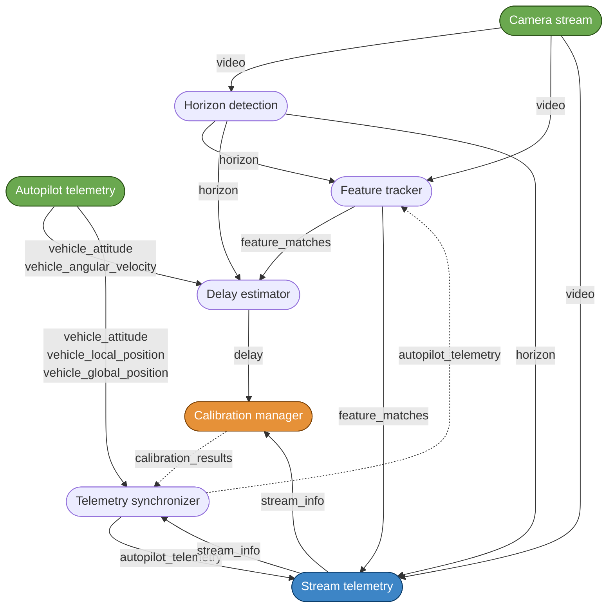
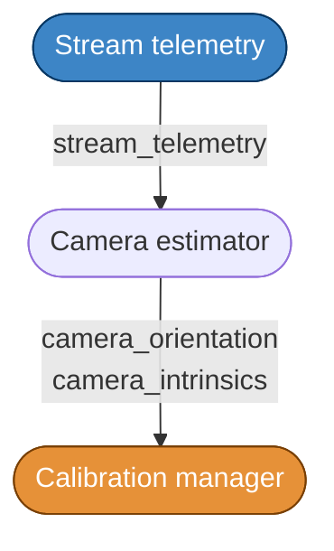
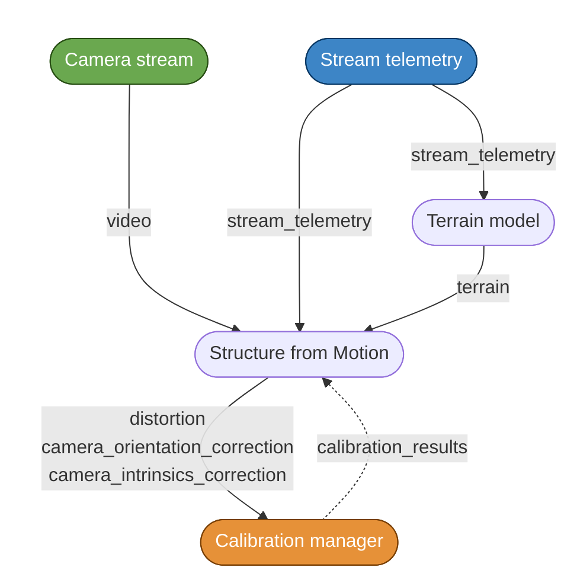

# IFC system diagram

## 1. Delay estimation

`stream_telemetry` has two roles: it first publishes `stream_info` (frame time, size, reset) as soon as a frame arrives, and then `stream_telemetry` (that `stream_info` plus synchronized telemetry, horizon and features) once all data of the frame have arrived.

## 2. Camera orientation and intrinsics

## 3. Distortion

